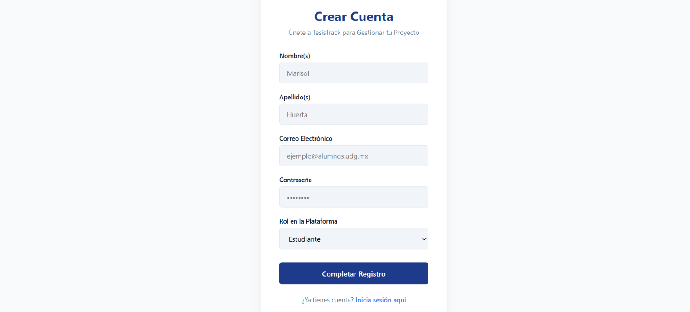
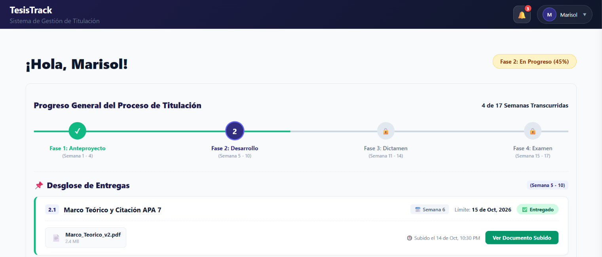
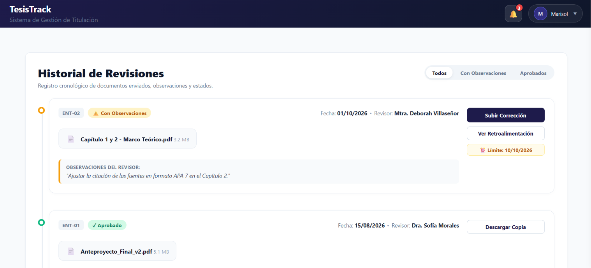
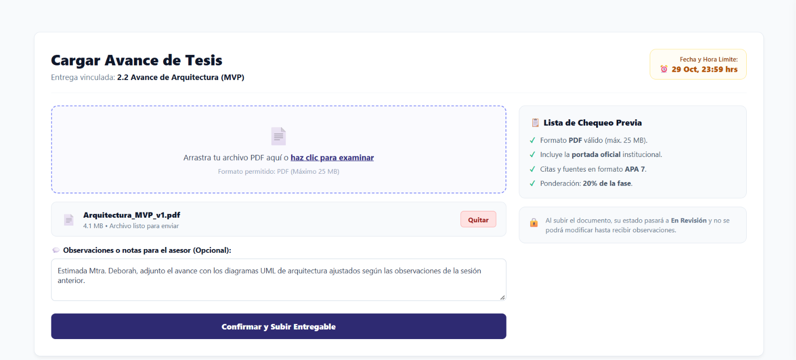
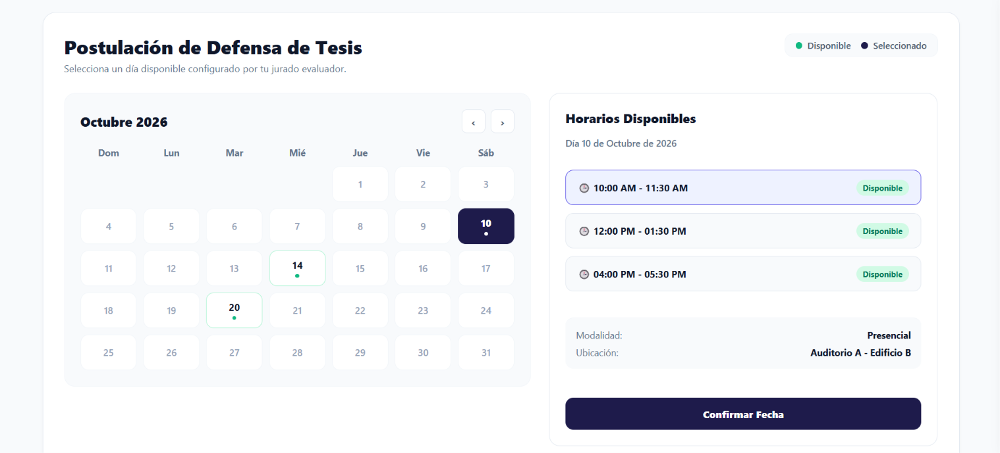

[Versión Español](./README.md)

# 🎓 TesisTrack - Degree Management and Tracking Platform

Comprehensive platform for tracking and managing the university degree process.

---

## 📋 Table of Contents
- [Description](#-description)
- [Demo and Screenshots](#-demo-and-screenshots)
- [Installation and Configuration](#-installation-and-configuration)
- [Usage and Automated Testing](#-usage-and-automated-testing)
- [Technologies and Stack](#-technologies-and-stack)
- [Project Structure](#-project-structure)
- [Technical Documentation (ADRs, Blockers, Technical Debts)](#-technical-documentation-adrs-blockers-technical-debts)
- [Contribution](#-contribution)
- [Authors](#-authors)

---

## 📖 Description

**TesisTrack** is a web system designed to manage and centralize the workflow between degree-seeking students, thesis advisors, and academic coordinators. It solves common issues like disorganization, loss of progress due to email threads, and lack of visibility into review statuses.

- **Target User:** University students in the degree process, thesis advisors, and academic program administrators.

- **Problem Solved:** Fragmented communication, lack of traceability in corrections, loss of documents, and delays in delivery and inspection times.

---

## 🎬 Demo and Screenshots

### Testing the Demo (Local Environment)

1. In the `.env` file, make sure you have configured the `PORT=5000` variable and the connection to your local database.

2. Start the application by running `npm run dev` and open `http://localhost:5173/login` in your browser.

3. Log in with the default test credentials (or register a new user):
   * **Admin Role:** `tesistrack@administracion.udg.mx` | Password: `administracion123`
   * **Teacher/Advisor Role:** `tesistrack@docentes.udg.mx` | Password: `docentes123`
   * **Student Role:** `tesistrack@alumnos.udg.mx` | Password: `alumnos123`

4. To test the main flow as a **Student**:
   * Go to the **Mis Entregas** (My Submissions) module and upload a progress file (PDF).

5. Log out and enter with the **Advisor** account at `http://localhost:5173/login`:
   * Check the **Revisiones Pendientes** (Pending Reviews) section.
   * Open the student's submission, add observations/comments, and change the status to **Aprobado** (Approved).

6. Return to the **Student** profile to verify how the history and graduation schedule update in real time.

### Screenshots

| Screen | Description |
| :--- | :--- |
|  | Registration and role selection screen. |
|  | Main panel with overall progress of the degree process and submission breakdown. |
|  | Chronological record of submitted documents, observations, and statuses. |
|  | Thesis progress upload with notes for the advisor. |
|  | Selection of thesis defense with available schedule configured by the evaluating jury. |

---

## 🚀 Installation and Configuration

### Prerequisites
Before starting, make sure to download and install the following necessary tools:

- **Node.js (LTS):** [Download Node.js](https://nodejs.org/) (Includes `npm` package manager)
- **MySQL Server / Workbench:** [Download MySQL](https://dev.mysql.com/downloads/installer/)
- **Git:** [Download Git](https://git-scm.com/downloads)

### Installation Step-by-Step

```bash
# 1. Clone the repository
git clone [https://github.com/MarisolHuertaa/TesisTrack.git](https://github.com/MarisolHuertaa/TesisTrack.git)

# 2. Enter the project folder
cd TesisTrack

# 3. Configure and start the Backend (Make sure to configure your .env file in this folder)
cd TesisTrack-Backend
npm install
node server.js

# 4. Configure and start the Frontend
cd TesisTrack-Frontend
npm install
npm run dev
```

---

## 💻 Usage and Automated Testing

### Startup Example
```bash
npm run dev
```
Then open your browser and go to `http://localhost:5173/login`.

### Automated Testing
```bash
# Run unit, integration, and acceptance test suites
npm test
```
### Official Console Output
```bash
PASS tests/unit.test.js (10 passed, 10 total)
PASS tests/integration.test.js (10 passed, 10 total)
PASS tests/e2e.test.js (10 passed, 10 total)

Test Suites: 3 passed, 3 total
Tests:       30 passed, 30 total
Snapshots:   0 total
Time:        2.548 s
```

### Main Features
✅ **Progress Upload:** Document management with version control.  
✅ **Real-Time Feedback:** Direct comments from advisors.  
✅ **Milestone Tracking:** Control of deadlines and institutional schedule.  
✅ **Progress Reports:** Statistics for academic coordination.

---

## 🛠️ Technologies and Stack

| Layer | Technology |
| :--- | :--- |
| **Frontend** | React |
| **Backend** | Node.js (Express) |
| **Database** | PostgreSQL / MySQL Workbench |
| **Authentication** | JWT (JSON Web Tokens) |
| **Testing** | Jest |
| **Hosting & CI/CD** | Vercel / GitHub Actions |

---

## 📁 Project Structure

```text
TesisTrack/
├── .github/                           # CI/CD workflows and GitHub templates
├── docs/                              # Technical and administrative project documentation
│   ├── adr/                           # Architecture Decision Records
│   ├── bloqueos/                      # Impediments and blockers log of the development team
│   ├── dt/                            # Technical debt tracking log
│   ├── screenshots/                   # Interface screenshots for documentation
│   └── CASOS_DE_PRUEBA.md             # Test cases definition and scripts
├── TesisTrack-Backend/                # REST API Server and business logic (Node.js/Express)
│   ├── controllers/                   # Controllers handling HTTP requests and logic
│   ├── middlewares/                   # Intermediate functions (JWT auth, validations, CORS)
│   ├── routes/                        # Definition of API routes and endpoints
│   ├── tests/                         # Automated server tests
│   │   ├── e2e.test.js                # End-to-End tests
│   │   ├── integration.test.js        # Integration tests between components and database
│   │   └── unit.test.js               # Unit tests of isolated functions
│   ├── .env                           # Local environment variables (credentials and ports)
│   ├── db.js                          # Database connection setup (MySQL)
│   ├── package-lock.json              # Exact dependency tree installed in backend
│   ├── package.json                   # Dependencies and scripts of the backend environment
│   └── server.js                      # Main entry point of the Express server
├── TesisTrack-Frontend/               # Client web application (React + Vite)
│   ├── public/                        # Static files accessible directly by the browser
│   ├── src/                           # Main source code of the interface
│   │   ├── assets/                    # Multimedia assets (images, logos, icons)
│   │   ├── componentes/               # Reusable UI components
│   │   ├── pages/                     # Main application views and screens
│   │   ├── services/                  # HTTP client (Axios) to consume backend API
│   │   └── styles/                    # Global stylesheets and modular CSS
│   ├── index.html                     # Base HTML template of the SPA (Single Page Application)
│   ├── package-lock.json              # Exact dependency tree installed in frontend
│   ├── package.json                   # Dependencies and scripts of the frontend environment
│   └── vite.config.js                 # Vite bundler and development server configuration
├── .gitignore                         # Files and folders excluded from version control
└── README.md                          # Primary repository documentation
```

---

## 📑 Technical Documentation (ADRs, Blockers, Technical Debts)

- **Architecture Decision Records:** Check the records of architectural decisions in [`docs/adr/`](./docs/adr/).
- **Blockers:** Check the log of development team impediments and blockers in [`docs/bloqueos/`](./docs/bloqueos/).
- **Technical Debt Log:** Check the accumulated technical debt tracking in [`docs/dt/`](./docs/dt/).

---

## 🤝 Contribution

Any contribution is welcome! Follow these steps to collaborate:

1. **Fork** the repository.

2. Create a branch for your contribution:  
   `git checkout -b feature/new-feature`

3. Save your changes with meaningful commits (Conventional Commits):  
   `git commit -m "feat(module): add new feature"`

4. Push your branch to GitHub:  
   `git push origin feature/new-feature`

5. Open a **Pull Request** detailing your changes.

### Commit Conventions
- `feat:` New feature.
- `docs:` Documentation addition.
- `fix:` Bug fix.
- `update:` Documentation changes.
- `refactor:` Code refactoring without changing functionality.
- `test:` Adding or updating tests.
- `chore:` Maintenance or configuration tasks.

---

## 👥 Authors

| Name | Role | GitHub |
| :--- | :--- | :--- |
| **Marisol Huerta** | Product Owner | [@MarisolHuertaa](https://github.com/MarisolHuertaa) |
| **Isaí Plascencia Tapia** | Scrum Master | [@isai15200502-cell](https://github.com/isai15200502-cell) |
| **Laura Paola García Casillas** | Development Team | [@Paurilulu](https://github.com/Paurilulu) |
| **Héctor Jovany Padilla López** | Development Team | [@hector09padillalopez-beep](https://github.com/hector09padillalopez-beep) |
| **Gaizka Alejandro Camacho Torres** | Development Team | [@gaizkacamacho0678-cloud](https://github.com/gaizkacamacho0678-cloud) |