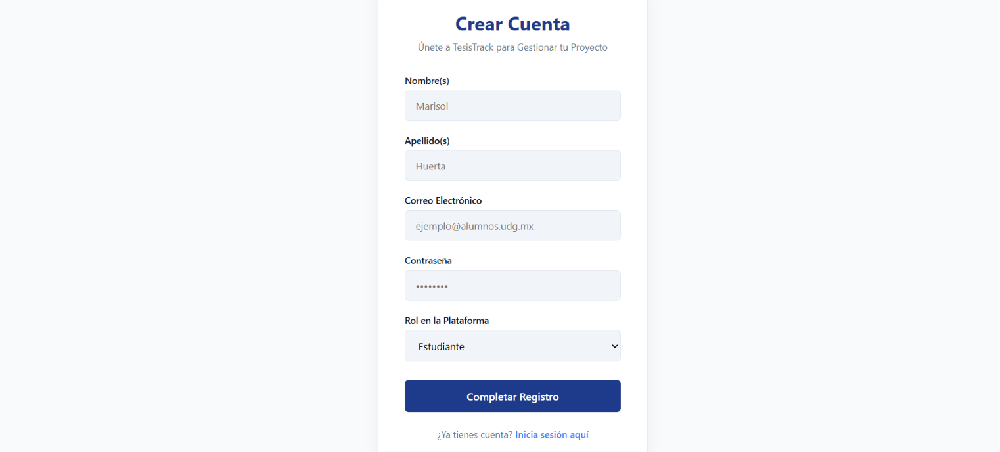
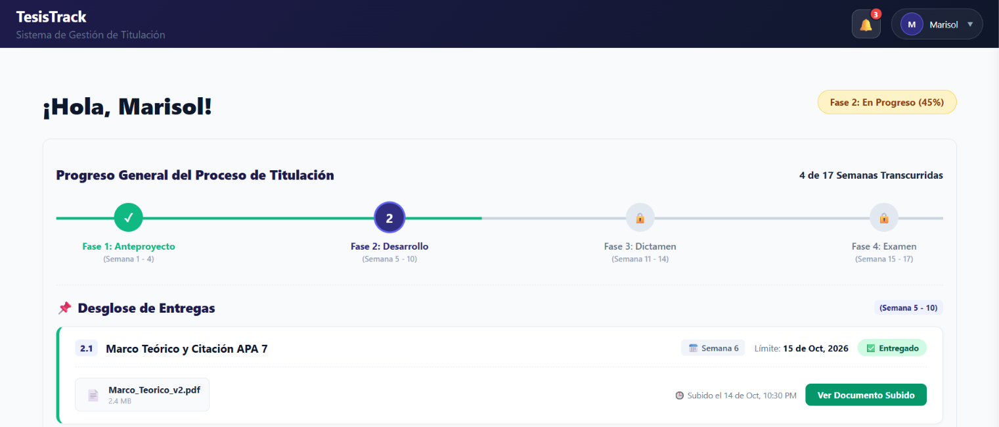
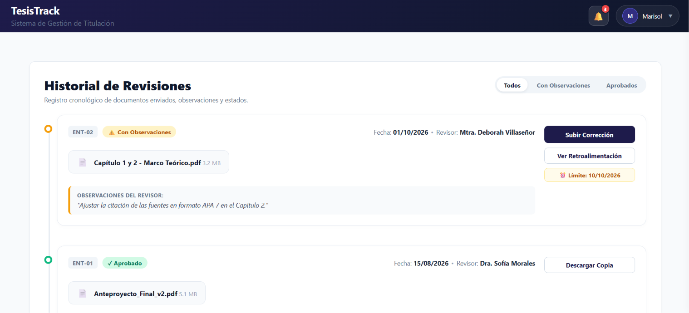
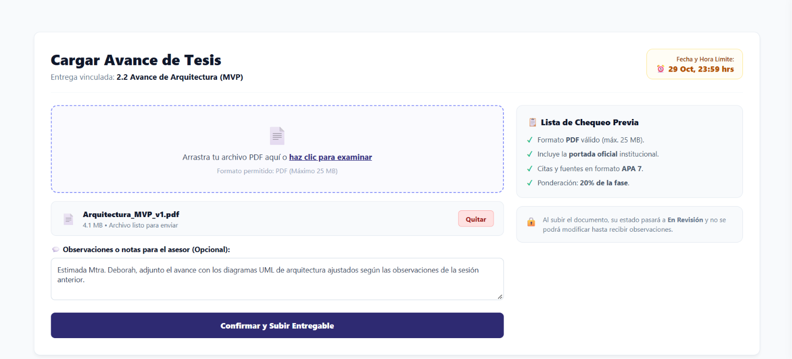
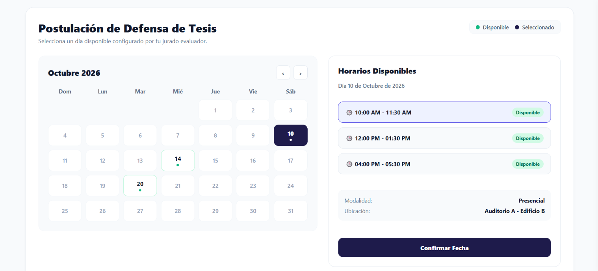

[English Version](./README.en.md)

# 🎓 TesisTrack - Plataforma de Gestión y Seguimiento de Titulación

[](https://github.com/MarisolHuertaa/TesisTrack/actions/workflows/pruebas.yml)


[](./LICENSE)

Plataforma web que centraliza la entrega, revisión y dictamen de documentos de titulación universitaria entre estudiantes, asesores y coordinación académica.

---

## 📋 Tabla de Contenidos
- [Descripción](#-descripción)
- [Demo y Capturas](#-demo-y-capturas)
- [Instalación y Configuración](#-instalación-y-configuración)
- [Uso y Pruebas Automatizadas](#-uso-y-pruebas-automatizadas)
- [API REST](#-api-rest)
- [Tecnologías y Stack](#️-tecnologías-y-stack)
- [Estructura del Proyecto](#-estructura-del-proyecto)
- [Documentación Técnica](#-documentación-técnica)
- [Contribución](#-contribución)
- [Licencia](#-licencia)
- [Autores](#-autores)

---

## 📖 Descripción

**TesisTrack** es un sistema web que gestiona y centraliza el flujo de trabajo entre estudiantes en proceso de titulación, asesores de tesis y coordinadores académicos. Resuelve la desorganización, la pérdida de avances en cadenas de correos y la falta de visibilidad sobre el estado de cada revisión.

* **Usuario objetivo:** estudiantes en proceso de titulación, asesores y sinodales, y coordinación académica.
* **Problema que resuelve:** comunicación fragmentada, falta de trazabilidad en las correcciones, pérdida de documentos y retrasos en los tiempos de revisión.

### Funcionalidades del MVP

| Funcionalidad | Historia | Estado |
| :--- | :--- | :--- |
| Línea de tiempo por fases (Anteproyecto → Desarrollo → Dictamen → Examen) | HU-01 | ✅ |
| Carga de avances en PDF (máx. 10 MB) con versión correlativa | HU-02 | ✅ |
| Notificaciones dentro de la plataforma al entregar y al dictaminar | HU-03 | ✅ |
| Dictamen del asesor (Aprobado / Con observaciones / Rechazado) con justificación obligatoria | HU-04 | ✅ API · 🚧 interfaz |
| Bloques de disponibilidad del docente para el examen | HU-06 | ✅ API · 🚧 interfaz |
| Solicitud de fecha de defensa (hasta 3 opciones) | HU-07 | ✅ |
| Semáforo de tiempos de respuesta para coordinación | HU-08 | 🚧 en desarrollo |

---

## 🎬 Demo y Capturas

### Probar la demo en tu computadora

1. Instala el proyecto y carga la base de datos siguiendo [Instalación y Configuración](#-instalación-y-configuración).
2. Abre `http://localhost:5173/login` e inicia sesión con alguna de estas cuentas de prueba (las crea `sembrarHashes.js`):

| Rol | Correo | Contraseña |
| :--- | :--- | :--- |
| Estudiante (fase 2, con observaciones) | `marisol.huerta@alumnos.udg.mx` | `DNI100001` |
| Estudiante (dictamen aprobado, puede agendar examen) | `isai.plascencia@alumnos.udg.mx` | `DNI100003` |
| Docente / Asesor de Marisol | `maria.rosas@docentes.udg.mx` | `DOC100001` |
| Coordinación | `coordinacion.titulacion@udg.mx` | `COORD2026` |

> Los demás estudiantes usan `DNI100001` a `DNI100028` y los docentes `DOC100001` a `DOC100015`, en el orden en que aparecen en `DATA.sql`.

3. **Flujo del estudiante:** entra como Marisol → **Mis Entregas** → sube un PDF. Si intentas subir un `.docx` o un PDF de más de 10 MB, el sistema lo rechaza.
4. **Flujo del asesor** 🚧 *(interfaz en desarrollo; la API ya funciona)*: entra como la Mtra. María Rosas → **Revisiones Pendientes** → abre la entrega, escribe observaciones y emite el dictamen. Al aprobar todos los hitos de la fase, la línea de tiempo del estudiante avanza.
5. **Agendar examen:** entra como Isaí → **Agendar Examen** → elige un horario disponible. Si el proyecto aún no tiene dictamen aprobatorio (por ejemplo, el de Marisol), la API rechaza la solicitud.

### Capturas de Pantalla

| Pantalla | Descripción |
| :--- | :--- |
|  | Pantalla de registro y selección de rol. |
|  | Panel principal con el progreso del proceso de titulación y el desglose de entregas. |
|  | Registro cronológico de documentos enviados, observaciones y estados. |
|  | Carga de avance de tesis con notas para el asesor. |
|  | Selección de fecha de defensa con los horarios configurados por el jurado. |

---

## 🚀 Instalación y Configuración

### Requisitos Previos

- **Node.js 20 LTS o superior:** [Descargar Node.js](https://nodejs.org/) (incluye `npm`)
- **MySQL 8 o MariaDB 10.6+** con **MySQL Workbench**: [Descargar MySQL](https://dev.mysql.com/downloads/installer/)
- **Git** o **GitHub Desktop:** [Descargar Git](https://git-scm.com/downloads) · [Descargar GitHub Desktop](https://desktop.github.com/)

### 1. Clonar el repositorio

```bash
git clone https://github.com/MarisolHuertaa/TesisTrack.git
cd TesisTrack
```

### 2. Crear y cargar la base de datos

Desde **MySQL Workbench**:

1. **File → Open SQL Script** → `TesisTrack-Backend/database/SQUEMA.sql` → ejecutar con ⚡. Crea la base `tesistrack` y sus 12 tablas.
2. En una pestaña nueva ejecuta `SET SQL_SAFE_UPDATES = 0;`.
3. **File → Open SQL Script** → `TesisTrack-Backend/database/DATA.sql` → ejecutar con ⚡. Carga 28 proyectos y 112 entregas de ejemplo.

O desde la terminal (Git Bash, macOS o Linux):

```bash
mysql -u root -p < TesisTrack-Backend/database/SQUEMA.sql
mysql -u root -p tesistrack < TesisTrack-Backend/database/DATA.sql
```

### 3. Configurar y arrancar el Backend

```bash
cd TesisTrack-Backend
cp .env.example .env        # en Windows: copy .env.example .env
# edita .env con tu usuario y contraseña de MySQL
npm install
node sembrarHashes.js       # asigna las contraseñas de las cuentas de prueba
npm run dev                 # API en http://localhost:5000
```

### 4. Arrancar el Frontend (en otra terminal)

```bash
cd TesisTrack-Frontend
npm install
npm run dev                 # aplicación en http://localhost:5173
```

---

## 💻 Uso y Pruebas Automatizadas

### Ejecutar las pruebas

Las pruebas **no necesitan MySQL**: usan una base de datos simulada en memoria (ver [ADR-005](./docs/adr/005-base-de-datos-simulada-en-pruebas.md)).

```bash
cd TesisTrack-Backend
npm test                    # 30 pruebas
npm run test:coverage       # además, reporte de cobertura en /coverage
```

### Salida en consola

```text
 PASS  tests/unit.test.js
 PASS  tests/acceptance.test.js
 PASS  tests/integration.test.js

Test Suites: 3 passed, 3 total
Tests:       30 passed, 30 total
```

| Tipo | Archivo | Casos | Qué verifica |
| :--- | :--- | :--- | :--- |
| Unitarias | `tests/unit.test.js` | CP-01 a CP-10 | Reglas de negocio aisladas (`utils/validaciones.js`) |
| Integración | `tests/integration.test.js` | CP-11 a CP-20 | Peticiones HTTP reales a la API con Supertest |
| Aceptación | `tests/acceptance.test.js` | CP-21 a CP-30 | Criterios *Dado / Cuando / Entonces* de las historias de usuario |

El detalle de cada caso, la evidencia y los defectos encontrados están en [`docs/CASOS_DE_PRUEBA.md`](./docs/CASOS_DE_PRUEBA.md). **GitHub Actions** ejecuta las pruebas en cada *push* y en cada Pull Request.

---

## 🔌 API REST

Todas las rutas, excepto registro y login, requieren el encabezado `Authorization: Bearer <token>`.

| Método | Ruta | Rol | Descripción |
| :--- | :--- | :--- | :--- |
| POST | `/api/auth/register` | Público | Registro con correo institucional `@...udg.mx` |
| POST | `/api/auth/login` | Público | Devuelve el token JWT (vigencia 8 h) |
| GET | `/api/proyectos/mi-proyecto` | Todos | Proyecto, entregas, hitos y notificaciones del usuario |
| POST | `/api/entregas/subir` | Estudiante | Sube un PDF (`form-data`: `archivo`, `hito_id`) |
| GET | `/api/entregas/pendientes` | Docente | Bandeja de entregas en revisión |
| POST | `/api/entregas/:id/dictamen` | Docente | `{ dictamen, comentario }`; avanza la fase al aprobar todos los hitos |
| GET · POST · DELETE | `/api/disponibilidad[/:id]` | Docente | Consultar, registrar o desmarcar bloques de horario |
| GET | `/api/proyectos/horarios-disponibles` | Estudiante | Horarios del comité asignado |
| POST | `/api/proyectos/confirmar-examen` | Estudiante | `{ fecha, horario }`; registra hasta 3 opciones |

---

## 🛠️ Tecnologías y Stack

| Capa | Tecnología |
| :--- | :--- |
| **Frontend** | React 19 + Vite |
| **Backend** | Node.js + Express 5 |
| **Base de Datos** | MySQL 8 / MariaDB |
| **Autenticación** | JWT (JSON Web Tokens) + bcrypt |
| **Carga de archivos** | Multer (solo PDF, máx. 10 MB) |
| **Testing** | Jest + Supertest |
| **CI/CD** | GitHub Actions |
| **Hosting (planeado)** | Vercel (frontend) / Render (backend) |

---

## 📁 Estructura del Proyecto

```text
TesisTrack/
├── .github/
│   ├── workflows/pruebas.yml          # CI: instala y ejecuta las pruebas en cada push y PR
│   └── pull_request_template.md       # Plantilla que se llena al abrir un PR
├── docs/
│   ├── adr/                           # Registros de decisiones de arquitectura
│   ├── bloqueos/                      # Registro de impedimentos del equipo
│   ├── dt/                            # Registro de deuda técnica
│   ├── screenshots/                   # Capturas de la interfaz
│   └── CASOS_DE_PRUEBA.md             # Matriz de 30 casos, evidencia y defectos encontrados
├── TesisTrack-Backend/
│   ├── config/                        # Conexión a MySQL (db.js) y secreto JWT (jwt.js)
│   ├── controllers/                   # Lógica de auth, proyectos, entregas, dictamen, disponibilidad y examen
│   ├── database/                      # SQUEMA.sql (tablas) y DATA.sql (datos de ejemplo)
│   ├── middlewares/                   # Verificación de token y rol; carga de PDF
│   ├── routes/                        # Definición de endpoints
│   ├── tests/                         # Pruebas unitarias, de integración y de aceptación
│   │   └── helpers/                   # Base de datos simulada y datos de prueba
│   ├── utils/validaciones.js          # Reglas de negocio reutilizables
│   ├── app.js                         # Configuración de Express (la usan el servidor y las pruebas)
│   ├── server.js                      # Punto de entrada: enciende la API
│   ├── sembrarHashes.js               # Asigna contraseñas a las cuentas de prueba
│   └── .env.example                   # Plantilla de variables de entorno
├── TesisTrack-Frontend/
│   └── src/
│       ├── components/                # Componentes y dashboards por rol
│       ├── pages/                     # Login, registro y paneles
│       ├── services/api.js            # Cliente Axios con el token JWT
│       └── styles/                    # Hojas de estilo
├── LICENSE
└── README.md
```

---

## 📑 Documentación Técnica

* **Decisiones de arquitectura (ADRs):** [`docs/adr/`](./docs/adr/)
* **Bloqueos:** [`docs/bloqueos/`](./docs/bloqueos/)
* **Deuda técnica:** [`docs/dt/`](./docs/dt/)
* **Casos de prueba:** [`docs/CASOS_DE_PRUEBA.md`](./docs/CASOS_DE_PRUEBA.md)

---

## 🤝 Contribución

El equipo trabaja con ramas y Pull Requests revisados. **Ningún cambio entra a `main` sin la aprobación de otro integrante.**

1. Actualiza `main` (en GitHub Desktop: *Fetch origin* → *Pull origin*).
2. Crea una rama con el prefijo del tipo de cambio: `feat/`, `fix/`, `test/` o `docs/`. Ejemplo: `feat/dashboard-asesor`.
3. Haz tus cambios y verifica que `npm test` pase.
4. Haz commits con el formato de Conventional Commits:
   `tipo(módulo): descripción`, por ejemplo `fix(auth): usar password_hash`.
5. Publica la rama y abre un **Pull Request**. Llena la plantilla y asigna a un revisor.
6. El revisor deja comentarios en **Files changed** y marca **Approve** o **Request changes**.
7. Se hace **merge** solo con la aprobación y con GitHub Actions en verde ✅.

### Tipos de commit
- `feat:` nueva funcionalidad
- `fix:` corrección de un error
- `test:` agregar o modificar pruebas
- `docs:` documentación
- `refactor:` cambio de código sin alterar su comportamiento
- `chore:` mantenimiento o configuración

---

## 📄 Licencia

Este proyecto se distribuye bajo la licencia **MIT**. Consulta el archivo [`LICENSE`](./LICENSE) para más detalles.

---

## 👥 Autores

Proyecto del **Seminario de Integración: Desarrollo** (7mo semestre, Grupo A), Centro Universitario de Tlaquepaque. Facilitadora: Deborah Leticia Villaseñor Basulto.

| Nombre | Rol | GitHub |
| :--- | :--- | :--- |
| **Marisol Huerta Catarino** | Product Owner | [@MarisolHuertaa](https://github.com/MarisolHuertaa) |
| **Isaí Plascencia Tapia** | Scrum Master | [@isai15200502-cell](https://github.com/isai15200502-cell) |
| **Laura Paola García Casillas** | Development Team | [@Paurilulu](https://github.com/Paurilulu) |
| **Héctor Jovany Padilla López** | Development Team | [@hector09padillalopez-beep](https://github.com/hector09padillalopez-beep) |
| **Gaizka Alejandro Camacho Torres** | Development Team | [@gaizkacamacho0678-cloud](https://github.com/gaizkacamacho0678-cloud) |
